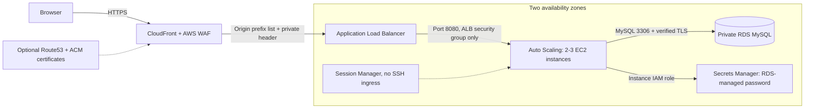

# AWS Two-Tier Infrastructure with Terraform

A modular AWS portfolio lab combining a protected web tier with a private, encrypted MySQL database. The web service exposes a liveness endpoint and a separate database readiness endpoint that executes `SELECT 1` over verified TLS.

**Validation status:** local checks and cloud deployment outcomes are recorded in [the validation report](docs/validation.md). Local provider mocks do not demonstrate an AWS deployment. Cloud resources must only be created after the cost estimate has been reviewed and spending approved.

## Architecture



The database subnets have no Internet route. EC2 instances have public IPv4 addresses for package downloads and AWS API access, but accept inbound application traffic only from the ALB security group. The ALB accepts only the CloudFront origin-facing prefix list and requires a generated origin header. This lab avoids NAT Gateway charges. See [design decisions and limitations](docs/decisions.md).

## Source assignment

Based on [DevCloudNinjas project 11: Two-Tier AWS Infrastructure with Terraform](https://github.com/DevCloudNinjas/DevOps-Projects/tree/ae6cf63837c9cb7a5f30471664e3fbf7c59da8d8/project-11-aws-2tier-terraform). Source revision: `ae6cf63837c9cb7a5f30471664e3fbf7c59da8d8`. This implementation uses smaller RDS MySQL instead of two Aurora instances and removes NAT gateways; it retains VPC, ALB, Auto Scaling, RDS, IAM, WAF and CloudFront, with optional Route53/ACM integration.

## Quick start: no AWS resources

Requirements: Linux x86_64, Python 3.12, Git, Make and Internet access. The database integration check additionally requires a running Docker daemon and OpenSSL.

```bash
bash scripts/setup.sh
make check
make integration
```

The setup installs Terraform 1.13.5 with an HTTPS-fetched SHA256 checksum, Python dependencies from the complete version lock, and signed Terraform providers from the committed provider lock. No AWS credential is required for mocked Terraform tests or local MySQL tests. The integration test starts a disposable MySQL 8.4 container on a randomly assigned loopback port and removes it and its anonymous volumes afterwards. Only Secrets Manager is stubbed; the database, TLS negotiation, SQL query and HTTP service are real.

Run the web tier locally without a database:

```bash
.venv/bin/python app/server.py
# In another terminal:
curl --fail http://127.0.0.1:8080/health
```

`/db` returns a sanitized HTTP 503 until a database and runtime secret binding are available. The integration suite supplies an isolated local test configuration.

## AWS deployment and cleanup

Follow [the deployment runbook](docs/runbook.md) and [cost estimate](docs/costs.md). Use an authenticated AWS role/profile provided securely by your environment. Never place credentials in Git, Terraform variables, screenshots or chat.

```bash
cp infra/terraform.tfvars.example infra/terraform.tfvars
export PATH=/workspace/tools/bin:$PATH
terraform -chdir=infra plan -out=deployment.tfplan
# After spending approval and plan review:
terraform -chdir=infra apply deployment.tfplan
make smoke URL="$(terraform -chdir=infra output -raw site_url)"
# Destructive: removes this lab and its database data with default lab settings.
terraform -chdir=infra plan -destroy -out=destroy.tfplan
terraform -chdir=infra apply destroy.tfplan
```

State, plans and local variable files are ignored because they may contain the origin token and operational details. Preserve state securely until teardown is confirmed. The default lab has no final database snapshot; do not store important data in it.

## Repository layout

- `infra/modules/network`: VPC, two public and two isolated database subnets, security groups.
- `infra/modules/database`: encrypted RDS, TLS enforcement, generated managed secret.
- `infra/modules/compute`: scoped IAM, ALB, immutable launch template, systemd service, ASG/CPU scaling.
- `infra/modules/edge`: CloudFront, AWS managed WAF rules and rate limiting.
- `app`: dependency-aware HTTP demonstration service.
- `tests`, `infra/tests`: application, real local database and mocked infrastructure tests.
- `docs`: deployment, architecture decisions, costs and verified evidence.

The GitHub Actions workflow performs local validation only and never provisions AWS resources.
